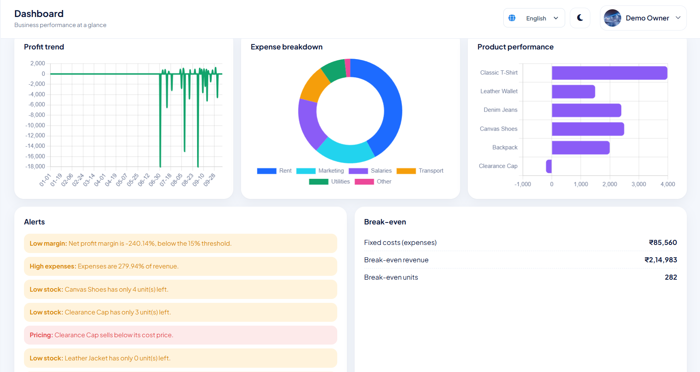
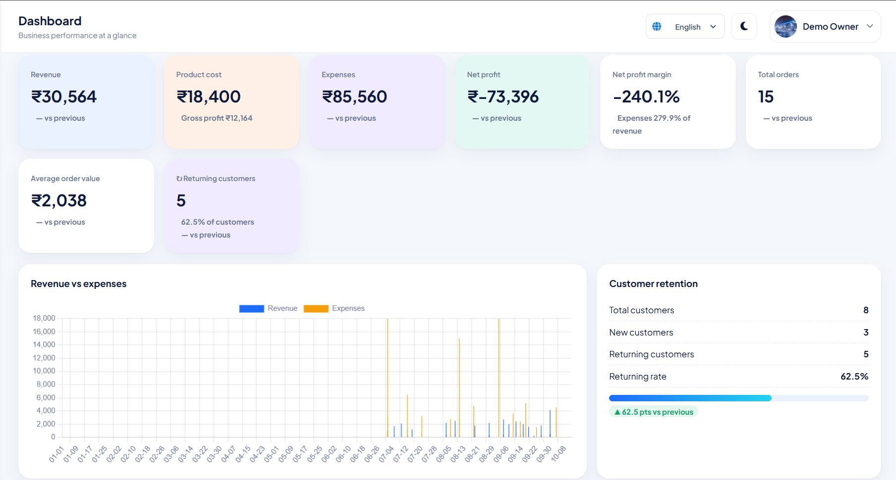
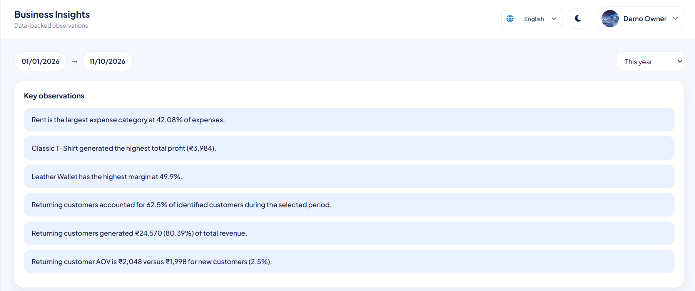
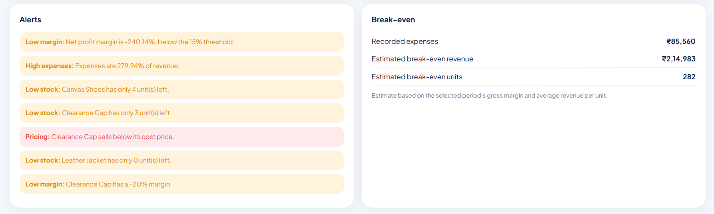

# BizLens — SMB's Decision Support System

**Turning everyday business data into actionable insights.**

BizLens is a full-stack business management and analytics platform designed for small and medium-sized businesses (SMBs). It brings products, inventory, customers, orders, and expenses into one centralized system and transforms operational data into meaningful business KPIs and decision-support information.

**Project type:** B.Tech Computer Science Engineering Academic Project  
**Role:** Project Lead  
**Repository:** [Meraj-Munshi/BizLens](https://github.com/Meraj-Munshi/BizLens)

---

## Table of Contents

- [Business Problem](#business-problem)
- [Key Features](#key-features)
- [Business Analytics](#business-analytics)
- [Technology Stack](#technology-stack)
- [System Architecture](#system-architecture)
- [Project Structure](#project-structure)
- [Getting Started](#getting-started)
- [Demo Data](#demo-data)
- [API Overview](#api-overview)
- [Business Rules](#business-rules)
- [Limitations](#limitations)
- [Security Notes](#security-notes)

## Business Problem

Small businesses often maintain sales, inventory, customer, and expense records across separate spreadsheets or disconnected systems. This makes it difficult to understand overall profitability, identify performance changes, monitor stock, and evaluate customer activity.

BizLens addresses this problem by combining operational data management with KPI-based analytics and rule-based business insights in a single web application.

## Key Features

### Business Operations
- Product and inventory management
- Customer records and order history
- Multi-product order creation and editing
- Order cancellation with stock restoration
- Expense tracking and expense categories
- Business profile and account management

### Analytics & Decision Support
- Business performance dashboard
- Revenue, product cost, profit, and margin analysis
- New and returning customer analysis
- Product and expense performance analysis
- Reporting-period comparisons
- Simplified break-even analysis
- Rule-based business insights and alerts

### Usability & Data Management
- JWT-based authentication
- CSV and XLSX data export
- Responsive browser-based interface
- Light and dark themes
- Multilingual interface support

## Dashboard & Analytics

 


## Business Insights & Break-even Analysis




## Business Analytics

BizLens calculates business indicators from recorded operational data.

| KPI | Calculation |
|---|---|
| Revenue | Sum of selling price × quantity |
| Product Cost | Sum of cost price × quantity |
| Gross Profit | Revenue − Product Cost |
| Net Profit | Gross Profit − Operating Expenses |
| Net Profit Margin | (Net Profit / Revenue) × 100 |
| Average Order Value | Total Revenue / Valid Orders |
| Expense-to-Revenue Ratio | (Expenses / Revenue) × 100 |

The application also supports period comparisons, product performance analysis, customer activity analysis, and simplified break-even analysis.

**Business alerts include:**
- Low-stock alerts
- Low-margin warnings
- Loss-making product warnings
- Expense-related observations
- Changes in business performance

These indicators are intended to support business understanding and decision-making. BizLens is not a substitute for statutory accounting or professional financial advice.

## Technology Stack

| Layer | Technologies |
|---|---|
| Frontend | HTML5, CSS3, JavaScript |
| Charts & UI | Chart.js, Font Awesome |
| Backend | Node.js, Express.js |
| Database | MySQL, mysql2 |
| Authentication | JWT, bcryptjs |
| Configuration | dotenv |
| Spreadsheet Export | XLSX |

## System Architecture

BizLens follows a layered full-stack architecture:

1. **Frontend:** Browser-based interface for business operations and analytics.
2. **Backend:** Express.js APIs for authentication, business rules, transactions, and analytics.
3. **Database:** MySQL relational database for products, customers, orders, inventory, and expenses.
4. **Analytics:** KPI calculations, period comparisons, business insights, and alerts based on recorded data.

## Project Structure

```text
BizLens/
├── backend/
│   ├── analytics.js
│   ├── db.js
│   ├── demo.js
│   ├── routes.js
│   ├── server.js
│   └── setup.js
├── database/
│   ├── demo.sql
│   └── schema.sql
├── frontend/
│   ├── assets/
│   ├── css/
│   ├── js/
│   └── index.html
├── .gitignore
├── package.json
├── package-lock.json
└── README.md
```

Create your own `.env` file locally. Do not commit it to Git.

## Getting Started

### Prerequisites

Install the following before running the application:

- Node.js
- npm
- MySQL

### 1. Clone the repository

```bash
git clone https://github.com/TheWeaponizzer/BizLens.git
cd BizLens
```

### 2. Install dependencies

```bash
npm install
```

### 3. Configure environment variables

Create a `.env` file in the project root:

```env
PORT=3000
DB_HOST=localhost
DB_USER=root
DB_PASSWORD=your_mysql_password
DB_NAME=bizlens
JWT_SECRET=replace_with_a_long_random_secret
```

Replace the example values with your local configuration. Use a strong, randomly generated JWT secret.

### 4. Initialize the database

```bash
npm run db
```

This script initializes the BizLens database and applies supported database setup or migration steps.

### 5. Load demo data (optional)

```bash
npm run demo
```

This command creates a demo business with sample products, inventory, customers, orders, and expenses.

The repository also includes `database/demo.sql` as an alternative demo-data source. Follow the credentials documented for the method you use.

### 6. Start the application

```bash
npm start
```

Open the application at:

http://localhost:3000

### Health Check

Check the backend and database connection at:

http://localhost:3000/api/health

The health endpoint reports whether the service and database connection are available.

## Demo Data

The demo dataset is intended for exploring the application's business workflows and analytics using sample operational records.

If you use the demo account, load the demo data first and use the credentials documented by the relevant demo-loading method.

Do not use demo credentials for production accounts.

## API Overview

BizLens exposes JSON API endpoints under `/api`.

| Area | Example endpoints |
|---|---|
| Authentication | `/api/auth/signup`, `/api/auth/login`, `/api/me` |
| Business Profile | `/api/business` |
| Products | `/api/products` |
| Customers | `/api/customers` |
| Orders | `/api/orders` |
| Expenses | `/api/expenses` |
| Analytics | `/api/analytics/dashboard`, `/api/analytics/products`, `/api/analytics/insights` |
| Export | `/api/export/:type` |
| Health | `/api/health` |

For request methods, parameters, and implementation details, refer to the backend route definitions.

## Business Rules

- Cancelled orders are excluded from business analytics.
- Returning customers are identified using valid order history.
- Order items retain the cost and selling prices recorded at the time of sale.
- Creating an order updates product stock.
- Cancelling an order restores the associated stock.
- Inactive products cannot be added to new orders.
- Reporting-period comparisons use the preceding period of the same length.

These rules help maintain consistency between operational records and analytical results.

## Limitations

BizLens focuses on operational business management, analytics, and decision support for SMBs. It is not designed to replace a complete enterprise resource planning or accounting platform.

The project does not aim to provide:
- Statutory accounting or tax filing
- Payroll processing
- Banking or payment-gateway integration
- Audited financial statements
- Professional financial advice
- Advanced enterprise resource planning

## Security Notes

- Keep `.env` out of source control.
- Never publish database passwords or private authentication secrets.
- Use a strong JWT secret.
- Use HTTPS and appropriate database permissions when deploying.
- Do not expose demo credentials as production credentials.

## Academic Context

BizLens is an academic project exploring how full-stack development, relational databases, business rules, and KPI-based analytics can be combined to support business decision-making.

The project synopsis discusses Business Intelligence and Analytics concepts, information integration, analytical decision-making, and the use of data in small and medium-sized businesses.

---

**BizLens — Manage business operations. Understand performance. Support better decisions.**
